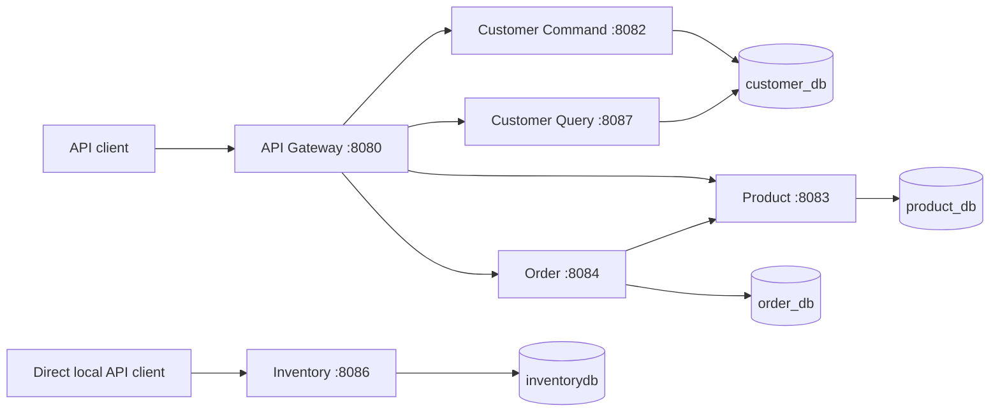

# Food Delivery Application


A backend microservices project featuring customer command/query separation, a product catalog, stock reservations, order processing, and a JWT-secured API gateway. This repository includes all six services, their existing tests, API documentation, and local database setup scripts.

## Services

| Service | Responsibility | Documentation |
|---|---|---|
| API Gateway | Routing, JWT validation, rate limiting and circuit breakers | [README](api-gateway/README.md) |
| Customer Command | Customer registration and updates | [README](customer-command-service/README.md) |
| Customer Query | Customer reads and searches | [README](customer-query-service/README.md) |
| Product | Product catalog and transactional inventory reservations | [README](product-service/README.md) |
| Order | Order lifecycle and Product Service integration | [README](spring-order-service/README.md) |
| Inventory | Independent product-code stock availability API | [README](inventory-service/README.md) |



This workspace contains six independent Spring Boot services. There is no root Maven reactor, so run each service from its own directory (or pass its `pom.xml` to Maven).

## Local prerequisites

- Java 25 and Maven 3.9 or newer
- PostgreSQL running on `localhost:5432`
- A PostgreSQL login that can create databases. Most service defaults use username `postgres` and password `root`; Product Service defaults to an empty password. Set `DB_USERNAME` and `DB_PASSWORD` to match your local PostgreSQL account.

Install JDK 25 separately; a runtime is not bundled in this repository. In every service terminal, set `JAVA_HOME` to your installed JDK and configure your local database credentials:

```bash
export JAVA_HOME=/path/to/your/jdk-25
export PATH="$JAVA_HOME/bin:$PATH"
export DB_USERNAME=postgres
export DB_PASSWORD='replace-with-your-local-password'
java -version
```

For a standard Homebrew PostgreSQL install, the database role is often your macOS username and may not have a password. In that case use `export DB_USERNAME="$(id -un)"` and `export DB_PASSWORD=` instead. Repeat the matching values in every service terminal.

Create the local databases once:

```bash
psql -d postgres -f database/setup-local.sql
```

The SQL creates `customer_db`, `product_db`, `order_db`, `inventorydb`, and `product_test` only when they are missing. Connect as a PostgreSQL role with database-creation privileges; add `-U <admin-user>` if your local admin role differs from your operating-system username. Existing databases are left as-is, so make sure `DB_USERNAME` owns each existing database or has permission to connect and create tables there. The inventory service inherits `DB_USERNAME` and `DB_PASSWORD` and also accepts `INVENTORY_DB_URL`, `INVENTORY_DB_USERNAME`, and `INVENTORY_DB_PASSWORD`. Order Service accepts `ORDER_DB_URL` to override its default database URL.

## Start the services

Open a separate terminal for each service, repeat the environment setup above in each terminal, and run the command from the project root. Run Customer Command first so it creates the customer tables before Customer Query starts. Product Service must be running before placing orders. Start the gateway after its backends.

```bash
mvn -f customer-command-service/pom.xml spring-boot:run
mvn -f customer-query-service/pom.xml spring-boot:run
mvn -f product-service/pom.xml spring-boot:run
mvn -f inventory-service/pom.xml spring-boot:run
mvn -f spring-order-service/pom.xml spring-boot:run
./api-gateway/mvnw -f api-gateway/pom.xml spring-boot:run
```

| Service | Port | Database |
|---|---:|---|
| API Gateway | 8080 | — |
| Customer Command | 8082 | `customer_db` |
| Product | 8083 | `product_db` |
| Order | 8084 | `order_db` |
| Inventory | 8086 | `inventorydb` |
| Customer Query | 8087 | `customer_db` |

Health endpoints are available at `/actuator/health` on each service that exposes Actuator. The gateway health endpoint is `http://localhost:8080/actuator/health`.

## Important integration details

- The Order Service uses Product Service (`8083`) for product lookups and transactional inventory reservations. The standalone Inventory Service (`8086`) currently serves the product-code availability API described in its README; it is not part of order placement or gateway routing.
- The gateway validates JWTs for protected routes. This workspace does not include an identity provider or token issuer. Public product reads and customer registration can be used without a token; protected customer, product-write, and order routes need a valid RS256 token from an external issuer. Configure `JWT_ISSUER_URI`, `JWT_JWK_SET_URI`, and `JWT_AUDIENCE` in the gateway environment.
- Services also expose their own ports for local development. Do not expose backend ports publicly; the gateway is the intended client entry point when authentication is configured.

## Useful local URLs

- Gateway: `http://localhost:8080`
- Product Swagger UI: `http://localhost:8083/swagger-ui.html`
- Order Swagger UI: `http://localhost:8084/swagger-ui.html`
- Inventory availability: `http://localhost:8086/api/inventory/P1001?quantity=2`
- Customer Command Swagger UI: `http://localhost:8082/swagger-ui.html`
- Customer Query Swagger UI: `http://localhost:8087/swagger-ui.html`

For service-specific configuration and API examples, see each service's README.

## Build and verification

Run each service's Maven lifecycle independently:

```bash
for service in api-gateway customer-command-service customer-query-service product-service spring-order-service inventory-service; do
  mvn -f "$service/pom.xml" clean verify || exit 1
done
```

Existing tests are included with their services. PostgreSQL integration tests may require additional database configuration; see [Product verification](product-service/docs/VERIFICATION.md). Inventory currently has no automated tests. Publishing this repository does not constitute a fresh full-system test run.

## Project scope

This repository showcases the backend. It does not include a frontend, hosted deployment, or JWT token issuer. Local development credentials and schema settings must be configured appropriately before deployment. See the service documentation for API behavior and verification limits.
