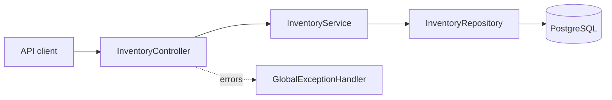

# Inventory Service · Java 25 LTS

A focused Spring Boot microservice that checks product stock against a requested quantity. Built with Java 25, Spring Data JPA, and PostgreSQL, this project demonstrates a layered REST API with input validation and structured error responses.


## Highlights

- Check stock availability by product code and requested quantity.
- Reject non-positive quantities and return a structured 404 for unknown products.
- Persist inventory through Spring Data JPA and PostgreSQL.
- Seed demo products using repeatable PostgreSQL inserts.
- Configure database connection and server port through environment variables.
- Compile and package on Java 25 LTS.

## Architecture



The controller validates the request, the service evaluates stock, and the repository retrieves the inventory record. Checking availability does not reserve or deduct stock.

## Run locally

Prerequisites: JDK 25, Maven 3.9 or newer, and PostgreSQL. Set `JAVA_HOME` to your installed JDK 25 and confirm `mvn -version` reports Java 25.

1. Create a PostgreSQL database:

   ```sql
   CREATE DATABASE inventorydb;
   ```

2. Set your connection details in the terminal:

   ```sh
   export INVENTORY_DB_URL=jdbc:postgresql://localhost:5432/inventorydb
   export INVENTORY_DB_USERNAME=postgres
   export INVENTORY_DB_PASSWORD='replace-with-your-local-password'
   ```

3. Build and start from the `inventory-service` directory:

   ```sh
   mvn clean verify
   mvn spring-boot:run
   ```

The API listens on `http://localhost:8086`. Demo rows are initialized at startup without overwriting existing rows.

## Try the API

```sh
curl 'http://localhost:8086/api/inventory/P1001?quantity=2'
```

Example response with the seeded data:

```json
{
  "productCode": "P1001",
  "productName": "Laptop",
  "availableQuantity": 10,
  "available": true
}
```

| Request | Expected behavior |
| --- | --- |
| `P1001?quantity=2` | Available with the seeded stock of 10 |
| `P1001?quantity=11` | HTTP 200 with `available: false` |
| `UNKNOWN?quantity=1` | HTTP 404 with `PRODUCT_NOT_FOUND` |
| `P1001?quantity=0` | HTTP 400 |

## Configuration

| Variable | Purpose | Default |
| --- | --- | --- |
| `INVENTORY_SERVER_PORT` | HTTP port | `8086` |
| `INVENTORY_DB_URL` | PostgreSQL JDBC URL | `jdbc:postgresql://localhost:5432/inventorydb` |
| `INVENTORY_DB_USERNAME` | Database user | `DB_USERNAME`, then `postgres` |
| `INVENTORY_DB_PASSWORD` | Database password | `DB_PASSWORD`, then local demo value |

Always supply your own database credentials. The included defaults and automatic schema updates are for local development.

## Project layout

```text
src/main/java/com/javacodeex/inventory/
├── controller/    HTTP endpoint and validation
├── service/       Availability logic
├── repository/    JPA queries
├── entity/        Inventory persistence model
├── dto/           API response
└── exception/     Structured error handling
src/main/resources/
├── application.properties
└── data.sql
```

## Java 25 validation

The service was verified with Microsoft OpenJDK 25.0.2 and Maven 3.10.0:

- `mvn clean test-compile -q` succeeded.
- `mvn clean verify -Djacoco.skip=false` succeeded and produced an executable JAR.
- Compiled class-file version 69 confirms Java 25 output.

There are currently no automated tests or coverage measurements. The dependency vulnerability scan did not complete, and database-backed startup was not exercised during the Java upgrade. See [upgrade notes](docs/java-25-upgrade.md).

## Scope

This is a backend portfolio/demo service. It does not include a frontend, authentication, stock reservations, or a hosted live demo. Before production use, add tests, authentication as needed, managed database migrations, and a completed dependency security review.
