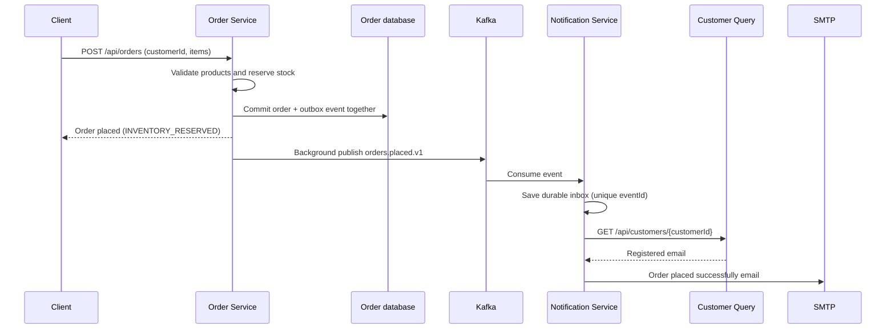

# Kafka Order Email Notifications

Java 25 / Spring Boot service that emails the customer's registered address after an order is placed and inventory is reserved. Order creation still returns immediately without waiting for Kafka or SMTP.

## Flow



The order request uses the existing `customerId`; do not add an arbitrary recipient to it. Register the customer with the desired email through Customer Command first. Customer Query currently shares that customer database, so Notification Service reads the registered email at delivery time. No registration-only email is sent.

## Local setup

From the project root:

```sh
# Requires Docker Compose; starts a single Kafka broker and a local test inbox.
docker compose -f compose.notifications.yml up -d

# Creates notification_db alongside the existing databases (no existing databases dropped).
psql -d postgres -f database/setup-local.sql

# Set these to your own local PostgreSQL credentials in each service terminal.
export DB_USERNAME=postgres
export DB_PASSWORD='your-local-password'
export KAFKA_BOOTSTRAP_SERVERS=localhost:9092

mvn -f notification-service/pom.xml spring-boot:run
```

Run Customer Command, Customer Query, Product, Order, and the gateway as described in the [root README](../README.md). Notification Service uses port **8088**. Start Notification Service before creating orders so it provisions the Kafka topics. Previously queued events are retried when the broker/topics become available.

With default mail settings, emails are captured locally at **http://localhost:8025** (Mailpit). They are **not delivered to real Gmail/other inboxes** until real SMTP is configured.

## Deliver to real email addresses

Set these variables in the Notification Service terminal, then restart the service:

```sh
export MAIL_HOST=smtp.gmail.com
export MAIL_PORT=587
export MAIL_USERNAME='your-sender@gmail.com'
export MAIL_PASSWORD='your-app-password'
export MAIL_FROM='your-sender@gmail.com'
export MAIL_SMTP_AUTH=true
export MAIL_STARTTLS=true
```

For another SMTP provider, use its host, submission port, credentials and verified sender. Keep credentials in environment variables or a secret manager, never commit them. Gmail requires an account eligible for app passwords; an ordinary account password is not appropriate. The example `.env.example` is documentation only; Spring Boot does not automatically load `.env` files.

A customer must exist for the order's `customerId` and have a valid email. Missing customers or unavailable Customer Query/SMTP are retried from the database with a capped backoff. Update the customer's email if needed; the next attempt reads it again.

## Configuration

| Variable | Default |
|---|---|
| `NOTIFICATION_PORT` | `8088` |
| `NOTIFICATION_DB_URL` | `jdbc:postgresql://localhost:5432/notification_db` |
| `DB_USERNAME` / `DB_PASSWORD` | Same local database convention as other services |
| `KAFKA_BOOTSTRAP_SERVERS` | `localhost:9092` |
| `ORDER_NOTIFICATION_TOPIC` | `orders.placed.v1` (set identically in Order and Notification) |
| `CUSTOMER_QUERY_URL` | `http://localhost:8087` |
| `MAIL_HOST` / `MAIL_PORT` | `localhost` / `1025` |
| `MAIL_FROM` | `orders@food-delivery.local` |
| `MAIL_USERNAME` / `MAIL_PASSWORD` | Empty |
| `MAIL_SMTP_AUTH` / `MAIL_STARTTLS` | `false` / `false` for local Mailpit |

Health: `http://localhost:8088/actuator/health`. No public notification-send endpoint is exposed.

## Reliability and operation

- The order and event commit together. Failed reservations do not create a success event, and rollback removes both order and event.
- Broker outages leave events in `order_notification_outbox`; the scheduled publisher retries. Published rows are retained for audit.
- Kafka acknowledgement follows a committed inbox insert. Duplicate `eventId` values are ignored, including after restart.
- Email failures retain the inbox row and retry with backoff (maximum five minutes). `attempts`, `next_attempt_at` and `last_error` support diagnosis without persisting SMTP error text or recipient addresses.
- Workers lock one pending row with `FOR UPDATE SKIP LOCKED`, preventing concurrent sends for the same row.
- SMTP is not transactional: a crash after SMTP accepts a message but before the database records success can cause a duplicate email. Exactly-once email delivery is not claimed.
- Invalid/unprocessable Kafka events are retried then sent to `orders.placed.v1.DLT`; monitor and replay repaired events to the original topic. DLT publishing failure does not silently acknowledge the original record.
- Monitor old pending outbox/inbox rows and the DLT. Sent/published audit rows require an operational retention policy.
- Confirmation means **order placed and inventory reserved**, not payment, shipment or delivery. A later cancellation does not retract an already queued confirmation; cancellation emails are outside this feature.
- Kafka and SMTP ports in Compose bind only to localhost. Production needs broker authentication/ACLs and protected service networking. The existing order API does not establish ownership of `customerId`; enforce identity-to-customer authorization before public production use.

## Event contract

Topic: `orders.placed.v1`, key: order ID, JSON schema version: 1.

```json
{"eventId":"bf5708a1-ad79-4bfa-847f-bbc50d54a209","schemaVersion":1,"orderId":7,"orderNumber":"ORD-123","customerId":101,"totalAmount":20.00,"occurredAt":"2026-10-12T00:00:00Z"}
```

No email address, password or authentication token is included in the event.

## Tests

```sh
mvn -f notification-service/pom.xml test
mvn -f spring-order-service/pom.xml test
```

Database/Kafka integration tests opt in with `TEST_POSTGRES_URL` and use temporary isolated schemas. The PostgreSQL role needs permission to create schemas in the selected database. Kafka runs embedded and SMTP/customer HTTP use local test servers; no real customer email is sent:

```sh
export TEST_POSTGRES_URL=jdbc:postgresql://localhost:5432/postgres
export TEST_DB_USERNAME='your-postgres-role'
export TEST_DB_PASSWORD='your-postgres-password'
mvn -f notification-service/pom.xml verify
mvn -f spring-order-service/pom.xml verify
```

Without `TEST_POSTGRES_URL`, integration tests are skipped; unit tests still run.
